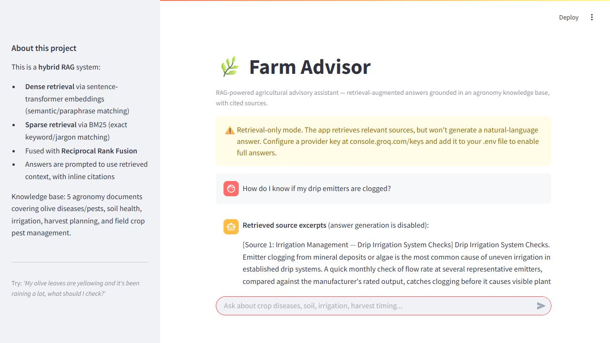

# Farm Advisor RAG

An agricultural question-answering prototype combining transformer embeddings, BM25 keyword retrieval, and Reciprocal Rank Fusion. Chroma stores the vector index; a Streamlit interface displays responses and retrieved sources.

## Architecture

Markdown documents → section-aware chunks → transformer or TF-IDF vectors + BM25 → ranked source excerpts → optional Groq or Anthropic answer generation.

The knowledge base contains five demonstration documents on olive pests, soil and fertilization, irrigation, harvest planning, and field crop pests. It is not a comprehensive or independently validated agronomy reference.

## Setup

Python 3.11 is recommended. Run from the repository root:

```powershell
git clone https://github.com/ahmedsafdar3-cloud/Farm-AdvisorRAG.git
cd Farm-AdvisorRAG
py -3.11 -m venv .venv
.venv\Scripts\Activate.ps1
python -m pip install -r requirements.txt
python src/ingest.py
python -m streamlit run src/app.py
```

The default embedder is `all-MiniLM-L6-v2`, downloaded on first use. If loading fails during ingestion, the pipeline falls back to TF-IDF. The selected backend is recorded with the index; querying loads that same backend to avoid incompatible vector dimensions.

To explicitly build an offline TF-IDF index:

```powershell
$env:FARM_EMBEDDING_BACKEND = "tfidf"
python src/ingest.py
```

`FARM_EMBEDDING_BACKEND` supports `auto` (default), `dense`, and `tfidf` during ingestion. Ingestion replaces the existing collection. Rebuild the index after changing the documents.

## Optional answer generation

Copy `.env.example` to `.env` and configure `GROQ_API_KEY` or `ANTHROPIC_API_KEY`. Groq is selected when both are present. Set `FARM_RETRIEVAL_ONLY=1` to disable generation even when keys are configured. Without either key, the application displays retrieved source excerpts and makes no LLM calls. Provider availability, quotas, and charges depend on your account. `.env` and the local index are excluded from Git.

Generation is prompted to use supplied sources and cite them. A prompt does not guarantee factual accuracy or correct citations. Verify any response against its sources before using it for farming decisions.

## Retrieval evaluation

```powershell
python eval/run_eval.py --top-k 4 --output eval/results.json
```

The command evaluates source retrieval without calling a generation provider. The checked-in [results](eval/results.json) record 15 questions, backend `sentence-transformers`, Hit@4 **100%**, and MRR **0.933**. These measure whether an expected source appears in the ranking, not answer correctness or performance on unseen real-world questions. The evaluation is small and authored for this knowledge base.

Offline regression check: `python -m unittest discover -s tests -v`.

## Files

| Path | Purpose |
| --- | --- |
| `data/` | Source documents |
| `src/chunking.py` | Document splitting and chunk metadata |
| `src/embeddings.py` | Transformer and TF-IDF backends |
| `src/ingest.py` | Build Chroma and BM25 artifacts |
| `src/rag_engine.py` | Retrieval, fusion, prompts, and provider calls |
| `src/app.py` | Streamlit interface |
| `eval/` | Questions, evaluation runner, and recorded results |

The local index and downloaded embedding model are generated artifacts. The repository currently has no open-source license.

## Interface preview



Retrieval-only example, captured from the running local application.
